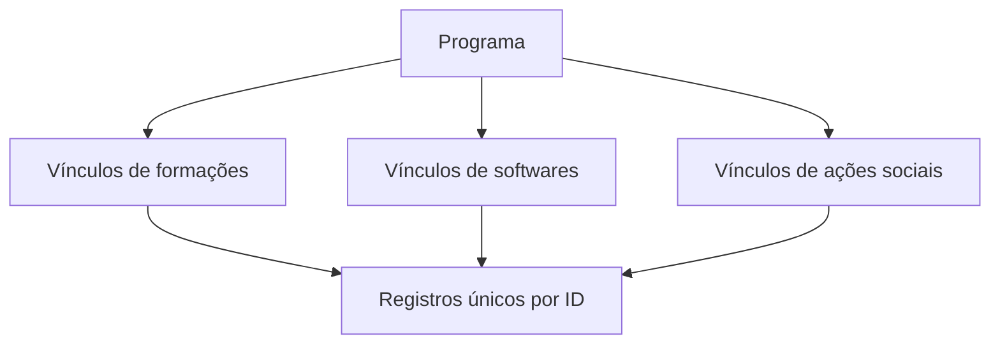
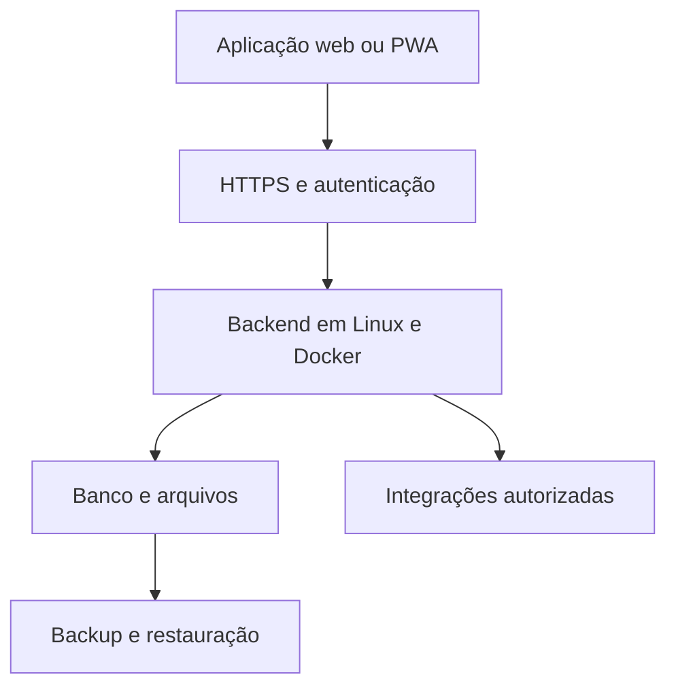
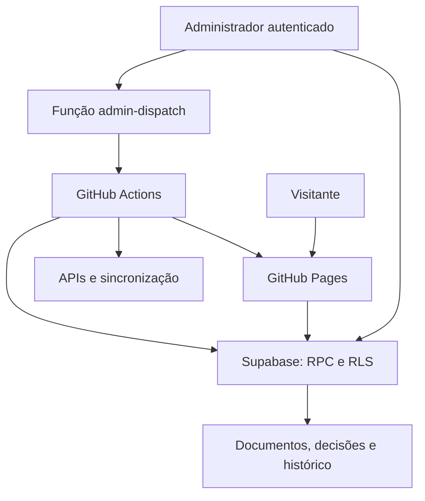

<<<<<<< HEAD
# Plataforma Global de Evangelização (PGE) · V46

**6 de novembro de 2026** · [Site publicado](https://plataforma-de-evangelizacao.github.io/site/)

Projeto comunitário cristão de evangelização, formação e participação solidária. Reúne estudos bíblicos, livros, palestras, projetos e indicações de fontes oficiais.

## Comece por aqui

- [Instalação e roteiro de conferência da V46](COMECE-AQUI-V46.md)
- [Painel administrativo](PAINEL-ADMINISTRATIVO.md)
- [Kit de backup e restauração com JSON local](https://chatgpt.com/library?file_id=libfile_a7ed57669fcc81918077e24aadd274bd&account_id=personal)

## O que mudou na V46

- O painel agrupa os menus em **Conteúdos** e **Administração**. Palestras e lives ficam junto dos demais conteúdos.
- A lista de conteúdos publicados ganhou o filtro **Atividades e instituições**. A lixeira distingue itens arquivados de excluídos e permite restaurá-los.
- O editor abre a ficha diretamente, com ações para publicar ou descartar. Instituições ganharam campos de endereço e site oficial. Atividades propostas podem ser movidas entre instituições.
- A página pública de Atividades distingue propostas de agendas oficiais e respeita o arquivamento.
- O catálogo audiovisual ganhou filtros por formato e quatro indicações com links oficiais. A disponibilidade depende da região e do serviço.

## Publicação e manutenção

A V46 é incremental sobre a V45 e dispensa nova migração do Supabase. O GitHub Pages publica o site e o Supabase sustenta o painel e os dados dinâmicos. Para a conferência em produção, siga o roteiro da V46.

O kit de backup atual é mantido separadamente e usa um JSON local. As referências ao kit V43 abaixo fazem parte do histórico.

---

# Plataforma Global de Evangelização v45
=======
# Plataforma Global de Evangelização v46
>>>>>>> e324d54d2a2eac9aa799486a68a175d3187fce5a

Consulte [Instalação](COMECE-AQUI-V45.md), [Alterações](docs/ALTERACOES-V45.md), [Testes](docs/TESTES-V45.md) e [Migração de chat](GUIA-MIGRACAO-PGE.md). A documentação da v44 segue abaixo para histórico.

# Plataforma Global de Evangelização v44

A versão 44 apresenta filmes e desenhos por indicação editorial de fontes oficiais. Consulte [Instalação](COMECE-AQUI-V44.md), [Alterações](docs/ALTERACOES-V44.md) e [Testes](docs/TESTES-V44.md). O backup Python e seu [guia](scripts/backup/README.md) são os da v43.

O GitHub Pages serve os cartões a partir de `assets/filmes-oficiais.js`. A manutenção do Supabase aplica `scripts/admin/platform-v44.sql` pelo manifesto versionado. Para adicionar um título, confira primeiro a página do distribuidor ou da loja oficial, a modalidade de acesso e a origem da capa. Registre um resumo próprio e informe restrições regionais quando conhecidas.

A API do Spotify fica para uma etapa posterior, com revisão editorial de playlists. A documentação abaixo registra a versão anterior.

---

# Plataforma Global de Evangelização

**Versão v43 · backend 2026.11.04.1 · 04/11/2026**

Conhecer a Palavra. Viver o amor. Compartilhar o cuidado. Projeto comunitário cristão com conteúdos autorais, formação, tecnologia e participação solidária. Cursos, palestras e softwares propostos são gratuitos; doações são voluntárias. Não se anunciam vagas, benefícios, parcerias ou implantação sem confirmação.

## Comece por aqui

1. Para atualizar o repositório existente, leia `COMECE-AQUI-V43.md`. O pacote de atualização preserva sua configuração de login, decisões editoriais e documentos já cadastrados.
2. Os workflows existentes publicam a página estática no **GitHub Pages** e aplicam as migrações no **Supabase**. São operações diferentes; sucesso do Pages não comprova sucesso do banco.
3. Faça o roteiro de `docs/TESTES-V43.md`, começando por programas e vídeos.
4. Antes de depender de recuperação, configure e ensaie `scripts/backup/README.md` em outro projeto Supabase e outro repositório.

Este README pode ficar público. Valores de tokens, senhas, connection strings, backups e cofres de recuperação não podem entrar no repositório público.

## O que mudou nesta versão

- Sete programas organizam 19 formações, seis softwares e nove ações sociais; fichas únicas e vínculos por ID.
- Vitrine com capas ilustrativas, busca, contadores reais, detalhes e links opcionais. Capas são ilustrações, não provas de software implantado.
- Formulários para criar, editar, ocultar, excluir, restaurar, alterar situação, vincular programas, parceiros, links e capas. Prévia antes de publicar e histórico de documentos.
- Gestão central de conteúdos, tipos e situações; lixeira de objetos e restauração por histórico para textos removidos.
- Aprovação em lote sequencial, com confirmação por item, contagem de sucesso/falha e repetição dos que falharam. Sem confirmação positiva do banco, o painel não declara publicação.
- Caixa de português opcional, sem fabricar certificação de idioma. Título e descrição exibidos podem diferir dos originais do YouTube.
- Miniaturas e prévia de vídeo em janela administrativa; filmes públicos passam a indicar fontes legítimas externas, sem player de filme no catálogo público.
- Procedência verificada por responsável humano e evidência registrada. Fontes pendentes ficam fora do catálogo público. IA e temática são filtros independentes do formato.
- IDs arquivados/bloqueados são ignorados antes de solicitar detalhes. Publicados não são novas descobertas; a checagem periódica de disponibilidade continua separada.
- Sessão de 20 minutos **sem interação**, sobrevivendo ao F5 na mesma aba. Requisições de acompanhamento não simulam atividade humana. Carregamento inicial não pisca a tela de login.
- Nova área Diagnóstico e problemas, relatório seguro para download, teste de conectividade e links das últimas execuções.
- Usuários convidados, superadministrador, administrador de conteúdo e permissões personalizadas por área; controles também no banco, não apenas no menu. O último superadministrador ativo não pode ser removido.
- Plano bíblico fixo extraído do PDF: 365 dias, três referências por dia, texto literal e links de consulta. Fevereiro 29 não foi inventado.
- Kit Python de backup criptografado, verificação de integridade, cópias Drive/GitHub, recuperação em destino separado e agendamento local Linux.

## Os programas

| Programa | Formações | Softwares | Ações sociais |
|---|---:|---|---:|
| Educação Inteligente | 2 | Escola Aberta | 0 |
| Município Inteligente 2040 | 4 | Município Inteligente | 0 |
| Campo Inteligente 2040 | 4 | Campo Conectado | 0 |
| Negócio Inteligente | 1 | Negócio Simples | 0 |
| Rede Solidária | 0 | Partilha Solidária | 4 |
| Cuidar e Aprender | 6 |  | 5 |
| Comunidade Conectada | 2 | Comunidade Organizada | 0 |

Todos os novos registros começam em desenvolvimento, com etapa de planejamento. Isso não modifica o estado de vídeos, playlists ou outros materiais existentes.

### As 19 formações

1. IA para Professores: Planejamento, Avaliação, Inclusão e Segurança.
2. IA para Alunos: Aprendizagem, Criatividade, Pensamento Crítico e Futuro Profissional.
3. Inteligência Artificial e Transformação do Serviço Público.
4. Gestão Municipal Baseada em Dados, Transparência e Indicadores.
5. Automação Administrativa, Atendimento e Gestão de Recursos.
6. Desenvolvimento de Soluções Públicas com IA: do Problema ao Protótipo.
7. IA no Campo: Gestão e Produtividade.
8. Produção Inteligente: Colheita, Café e Pecuária.
9. Agricultura Digital: Sensores, Água, Solo e Sustentabilidade.
10. Comercialização, Rastreabilidade e Inovação Rural.
11. Inclusão Digital e Aprendizagem para Crianças e Adolescentes em Acolhimento.
12. Criatividade, Estudos e Projetos de Vida com IA.
13. Trabalho, Empreendedorismo e Ferramentas Digitais para Pessoas Acolhidas.
14. Gestão de Casas de Apoio, Comunicação e Organização de Equipes.
15. Autonomia Digital e Prevenção de Golpes para Pessoas Idosas.
16. IA, Memória, Arte e Convivência na Terceira Idade.
17. Inteligência Artificial para Comunicação, Educação e Projetos Comunitários.
18. Gestão de Voluntariado, Doações e Prestação de Contas.
19. Inteligência Artificial para Pequenos Negócios: Gestão, Vendas, Marketing e Empreendedorismo.

### Os seis softwares

- **Escola Aberta**: Gestão escolar, organização de informações, atividades, calendário, comunicação e módulos de transporte escolar.
- **Município Inteligente**: Gestão de solicitações administrativas, processos, indicadores, relatórios e apoio à administração pública.
- **Campo Conectado**: Gestão de propriedades rurais, produção, colheitas, equipamentos, mapas de áreas e possibilidades de integração com sensores.
- **Comunidade Organizada**: Gestão de organizações comunitárias, voluntários, atividades, comunicação e acervo digital.
- **Partilha Solidária**: Gestão de campanhas, doações, estoque, distribuição de materiais e voluntariado.
- **Negócio Simples**: Gestão de pequenos negócios, vendas, estoque, clientes, despesas, relatórios e experiência de uso em dispositivos móveis.

Esta atualização organiza a apresentação e a gestão desses softwares; não implementa seis sistemas de produção. Arquitetura de referência: aplicação web responsiva, possível PWA, backend e banco quando necessários, servidor Linux, Docker, HTTPS, autenticação, permissões, backups e futuras APIs. GitHub Pages hospeda a parte estática; não substitui backend seguro.





## Dados, vínculos e preservação

`dados/programas.json` possui `programas`, `formacoes`, `softwares`, `acoes` e `legado`. Cada ficha tem ID estável; formações/softwares/ações indicam seus programas em uma lista de IDs. Editar um software afeta todas as suas aparições, sem duplicar registros. Alterar título não altera o ID. Novos IDs são gerados pelo formulário.

Campos principais: título, subtítulo, descrição curta/completa, capa/alt, situação, etapa, ordem, datas, links, visibilidade e traduções. Programas e ações admitem parceiros por `parceiro_id`, situação de participação e papel. Só relações confirmadas devem ser apresentadas como parceria efetiva.

O inventário encontrou **22 projetos principais + 45 formações internas = 67 fichas**, e não um contador fixo de 63. O mapa de consolidação está em `docs/INVENTARIO-MIGRACAO-V43.md`. Os documentos originais continuam acessíveis administrativamente, com cópia no histórico da migração. Referências ao legado não apagam textos ou módulos anteriores. Ações sociais e materiais editoriais anteriores permanecem preservados.

Os novos documentos compartilhados usam uma fonte única para os idiomas. A interface possui português, inglês e espanhol. As fichas admitem traduções por campo; conteúdo sem tradução usa português. Não há serviço de tradução automática contratado nem promessa de tradução humana já concluída. As referências do PDF permanecem literais em todos os idiomas.

## Arquitetura do site



- **GitHub Pages:** HTML/CSS/JavaScript, imagens e cópia estática dos dados.
- **Supabase/PostgreSQL:** `pge_documents`, `pge_live_documents`, `pge_video_decisions`, `pge_videos`, `pge_commands`, `pge_document_versions`, `pge_members` e versões do backend.
- **Supabase Auth:** autenticação por e-mail/senha, refresh token e convites. Não existe cadastro público de administradores.
- **Supabase Storage:** bucket `pge-covers`, somente imagens JPEG/PNG/WebP de até 2 MB. Arquivos enviados têm nomes únicos e prefixo do usuário. Upload não publica a ficha automaticamente; é preciso salvar/publicar.
- **GitHub Actions:** descoberta externa, revalidação, cópia do conteúdo e instalação do backend.
- **Python local:** backup e recuperação; funciona sem manter o navegador aberto.

A publicação de uma decisão ou documento é uma transação no Supabase e dispensa esperar o Actions. A página pública consulta esses dados, sem cache persistente, e faz nova verificação a cada dez segundos enquanto visível. Ao recarregar a página, consulta novamente. O tempo real depende da rede e não tem garantia fixa de três segundos. As buscas no YouTube continuam sujeitas à fila do GitHub e às cotas; um clique não elimina esses limites.

Se o backend de conteúdo estiver indisponível, o site falha de forma fechada para não reapresentar conteúdo removido a partir de uma cópia antiga. O painel registra o erro e não confunde falha de comunicação com lista vazia.

## Autenticação e permissões

A primeira conta é criada em Authentication → Users e autorizada uma única vez em `pge_admins`, conforme `PAINEL-ADMINISTRATIVO.md`. A migração v43 converte os administradores existentes em superadministradores. Os próximos usuários entram por convite na tela Usuários e permissões.

| Perfil | Permissões |
|---|---|
| Superadministrador | Todas as áreas, usuários, integrações e manutenção |
| Administrador de conteúdo | Conteúdos, vídeos e diagnóstico; sem conceder acesso nem executar manutenção de infraestrutura |
| Personalizado | Telas e operações selecionadas; RPC/RLS validam as mesmas restrições |

Convites dependem da entrega de e-mail do Supabase/SMTP e da URL de redirecionamento cadastrada. Ao abrir o convite, o usuário define sua senha. A URL perde o fragmento de autenticação imediatamente. Não mande senha ou token pelo chat.

A sessão usa `sessionStorage`, restrito à aba: sobrevive ao F5, termina ao sair ou após 20 minutos sem interação. Não armazena senha. Clicar, digitar, tocar ou rolar conta como atividade; polling não conta. XSS continua sendo uma ameaça a sessões no navegador: entradas são tratadas como texto e URLs executáveis são rejeitadas no backend.

## Chaves e configuração

| Onde | Nome exato | Como obter / finalidade |
|---|---|---|
| `admin/config.json` público | `supabaseUrl` | Settings / API do projeto Supabase; URL HTTPS |
| `admin/config.json` público | `publishableKey` | API Keys → Publishable key; jamais chave secret/service_role |
| GitHub Actions Secret | `SUPABASE_URL` | Mesma URL do projeto |
| GitHub Actions Secret | `SUPABASE_SERVICE_ROLE_KEY` | Chave de serviço no Supabase; somente backend |
| GitHub Actions Secret | `SUPABASE_ACCESS_TOKEN` | Conta Supabase → Access tokens; acesso ao projeto para migrações/funções |
| GitHub Actions Secret | `PLATFORM_DISPATCH_TOKEN` | Token GitHub com Actions write no repositório do site; o workflow o mapeia para `GITHUB_DISPATCH_TOKEN` |
| GitHub Actions Secret | `YOUTUBE_API_KEY` | Google Cloud → habilitar YouTube Data API v3 → Credentials; limitar uso/cotas |
| Função Supabase | `GITHUB_DISPATCH_TOKEN` | Configurado pelo atualizador com o valor de `PLATFORM_DISPATCH_TOKEN` |
| Função Supabase | `ADMIN_ALLOWED_ORIGIN` | Origem HTTPS exata do site; padrão do repositório atual |
| Cofre local de backup | Conexão PostgreSQL, tokens e OAuth Drive | Configuração local criptografada; nunca pública |

GitHub: repositório → Settings → Secrets and variables → Actions → New repository secret. O nome **não pode começar com `GITHUB_`**. Use `PLATFORM_DISPATCH_TOKEN`. Não cole dois nomes/valores no mesmo campo.

O token do Supabase precisa pertencer à conta/organização correta e ter acesso às operações usadas: migrações, funções/segredos e configurações de Auth quando usado pelo kit de recuperação. Um token restrito apenas ao projeto antigo não consegue restaurar em um projeto novo. Use o menor escopo necessário às funções que você vai executar.

O token de disparo em produção precisa somente das permissões de execução adequadas ao site. O token de **backup/recuperação** é separado e precisa ler código/branches e criar/gravar repositórios, configurar Pages, Actions, workflows, variables e Secrets nos destinos autorizados. Nunca envie esse token ao frontend.

`GITHUB_TOKEN` é fornecido automaticamente pelo Actions. Ele não é o nome de um Secret a criar e não substitui necessariamente um token que dispara outro workflow.

Referências oficiais: [Secrets GitHub](https://docs.github.com/en/actions/reference/security/secrets), [API de Secrets](https://docs.github.com/en/rest/actions/secrets), [Backup Supabase](https://supabase.com/docs/guides/platform/backups), [restauração Supabase](https://supabase.com/docs/guides/platform/migrating-within-supabase/backup-restore).

## Atualizações, integrações e diagnóstico

- **Recarregar painel:** consulta novamente os dados; não pesquisa YouTube/Spotify.
- **Sincronizar cópia no GitHub:** copia decisões/documentos já publicados no Supabase para o repositório; não inicia descoberta.
- **Buscar no YouTube:** executa descoberta limitada; arquivados/bloqueados por ID não voltam e duplicados são contados. Revisão de fonte é independente da descoberta.
- **Publicar cópia estática:** solicita o workflow Pages; não é requisito para que uma edição direta já seja lida pelo visitante.
- **Atualizar backend:** aplica somente migrações pendentes, compara checksums, instala a função e confere versão/resposta. Depois da configuração inicial, esse é o caminho normal, sem SQL manual repetido.
- **Spotify, músicas, podcasts e outras fontes:** botões não configurados permanecem identificados como tal. Credenciais, fontes e regras editoriais específicas ainda precisam ser configuradas. Não simula buscas inexistentes.

O frontend consulta o estado a cada segundo; a reconciliação com a API do GitHub é mais espaçada para respeitar limites. Porcentagem significa etapa confirmada, não estimativa inventada do tempo total. O painel exibe tempo decorrido, resposta média das APIs quando medida, contadores e resultado. Um pedido sem confirmação de início por cinco minutos é marcado como falha de início, sem concluir que o YouTube estava lento.

Diagnóstico consulta sessão/banco/função/GitHub e oferece relatório JSON sanitizado com códigos, etapa, duração e identificador de ocorrência. Não inclui tokens, senhas, cabeçalhos ou payloads completos. Falha de rede/CORS pode impedir observar o backend; nesse caso informa limite de observação em vez de atribuir uma causa exata sem evidência. O histórico local do diagnóstico fica na aba e pode ser baixado antes de encerrar.

## Diretriz de fontes legítimas

A plataforma indica fontes legítimas e mantém pendente aquilo cuja autorização não conseguiu verificar. Um título estar no YouTube ou permitir incorporação não prova licença. Não existe algoritmo confiável que determine sozinho os direitos de todos os uploads.

No acervo, registre URL oficial/autorizada e evidência da revisão. O catálogo público mostra título, imagem quando apropriada, descrição e acesso externo, inclusive quando o acesso exige assinatura, aluguel ou compra. Use somente capas autorizadas; a disponibilidade da imagem na internet também não é licença.

Para fontes fora do YouTube, use Conteúdos do site → Catálogo de fontes legítimas. Cadastre formato, link, plataforma, condição de acesso e evidência. A ficha só entra após revisão. Este mecanismo não implementa varredura indiscriminada de Netflix ou outros streamings, nem contorna acesso pago. A revisão continua humana. Materiais próprios e pregações de fontes oficiais seguem a mesma atenção à autoria.

Os três links indicados por Marcos estão em `biblioteca-controle/links-para-revisao.json` e entram como candidatos na descoberta. Não foram certificados nem aprovados automaticamente.

## Plano de leitura do PDF

`dados/plano-biblico.json` preserva 365 linhas e 1.095 referências do PDF recebido. Cada data usa a chave mês-dia, repetível nos anos seguintes; não usa sorteio. Links de consulta expandem abreviações para o mecanismo de busca bíblica, mantendo o texto de exibição literal. Erros de grafia ou numeração do original não foram corrigidos silenciosamente.

29 de fevereiro recebe uma nota de ausência no documento e não inventa três passagens. O plano completo é indicado na pasta Drive fornecida pelo autor. Isso não substitui revisão humana das referências ambíguas do PDF.

## Testes e operação

```text
python scripts/validar_site.py
python -m unittest discover -s tests/admin -v
python -m unittest discover -s tests/biblioteca -v
npm ci --prefix tests/admin/sql-test --ignore-scripts --no-audit --no-fund
node tests/admin/sql-test/v43.cjs
node tests/admin/sql-test/display.cjs
node tests/admin/sql-test/maintenance.cjs
node tests/admin/test_session.cjs
node tests/admin/test_dispatch.cjs
```

Instale `cryptography` para os testes de recuperação. Os testes usam dados fictícios e não consomem cota do YouTube. O ensaio autenticado com seu banco, SMTP, Drive, Pages e seus tokens só pode ser confirmado depois da instalação e configuração desses serviços. Consulte `docs/TESTES-V43.md` para a sequência e os resultados locais registrados.

## Recuperação e continuidade

Leia `scripts/backup/README.md`. O kit salva pasta criptografada, checksums, Git bundle de todas as branches, arquivos HEAD, schema/dados públicos, usuários/identidades Auth, buckets e arquivos Storage, configurações de Auth quando autorizado, variáveis e metadados de Secrets e valores conhecidos no cofre local.

**GitHub não devolve os valores de Secrets.** O kit só restaura valores previamente fornecidos ao cofre. Conta nova, plano/cotas, senha do banco e chaves do novo projeto exigem configuração autorizada. O script não cria contas nem aceita contratos por você. O ensaio usa um Supabase novo e repositório novo, mantém os originais protegidos e deixa o ambiente de teste disponível para conferência; não apaga automaticamente o banco.

Um backup verificado por checksum não prova restauração funcional. Faça o ensaio e o teste de edição descritos no guia. Não espere um incidente para descobrir se consegue restaurar.

## Histórico e documentos

- `docs/INVENTARIO-MIGRACAO-V43.md`: todas as fichas anteriores e seus destinos propostos.
- `docs/TESTES-V43.md`: roteiro e verificações desta versão.
- `scripts/backup/README.md`: instalação, rotina diária e restauração.
- `docs/HISTORICO-README-ATE-V42.md`: documentação anterior preservada como histórico. Em caso de divergência, este README e os manifestos v43 prevalecem.

Nenhuma implantação de produção ou uso de credenciais reais foi feito durante a preparação deste pacote.
